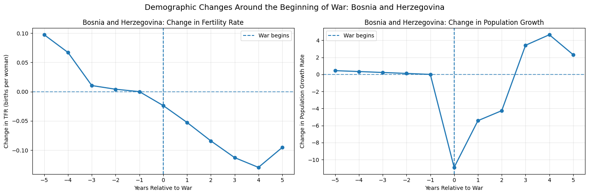

# countries:
- turkey (main country)
- egypt
- gorgia

let's start again from scratch, and pick the project theme and idea again. 

first thing we gonna pick several countries to do analytics with them and Turkey will be the main country that compare everything else with it.
let the question related to the idea of war and its effects \

migration and population.
how war change the demographic of our generation?

---

For your project, I recommend choosing 5–6 countries that experienced wars at different times and in different regions. This will make your comparisons more interesting and help you investigate whether war affects fertility, population growth, and migration in similar ways across countries.

## 1. Recommended countries

[Surreal Tours](https://images.openai.com/static-rsc-4/XnGU_n3Ea7sg3wVltb7pSfSF7GPKY1_Aweu2JPXrnLMldrE4v4wEl3tp1uVWiTa9CNxCeKAGnX0plusBN8g1hGQswlPqgI21ndQwKtMEKF2V5sWyy0KGEvl-3EoUdBZl-_dtPb_4zbSNY1DS_j1jjkwcv7wp-qOa05jyYYgwAlA?purpose=inline)

1\. Bosnia and Herzegovina

Bosnian War: 1992–1995

A useful case for comparing population and age structure before, during, and after a relatively clearly defined conflict.

[Best Reasons for Visiting Tourist Attractions in Kigali](https://images.openai.com/static-rsc-4/oERgjeuSpRfiIBeDcllrA8L2F8cn9KFV4nsiFTEbuyXBUGrFWT9vMdshVOYLrDEekMkx2YpU1QbAUat2ilSXBtOSAxsbXsJRErpZ51gfU5Bl7vu21pid7a4hDGo23Wt5HKLXBdmp69VJzzP4RreTgVmOqKAPN255Plamm3m3rx4?purpose=inline)

2\. Rwanda

Civil war: 1990–1994

Useful for studying major demographic disruption and changes in population structure.

[10 Best Beaches in Sri Lanka | Celebrity Cruises](https://images.openai.com/static-rsc-4/MrMlCdaYLFWMzAievuxkTEP4_Y54Giu9xtP49TJ5EDN-q-W49aKZz4u5CGKphN2nVRInLmX9wOrfYT2b1sQ9dHGAe6v4a6LPKRkXFz11Dw6od7apcY2OqSKKy0wes03w-UVSegqihqDWUE6DqUkU3HCwIB_PKOaUyjUNr_bCPhs?purpose=inline)

3\. Sri Lanka

Civil war: 1983–2009

Useful for examining a long conflict and its relationship with fertility and migration patterns.

[Lovable App](https://images.openai.com/static-rsc-4/pjxlzWv9T733T8_c8_DTA7utd7G1YuHeR-2yqjcZSElYPudhgMLFiTXCLTQp9KPp6EE3XbmzLty9TYNrNB4qjJftNliiCbbXcZDA2xCyB40bw5p1lGiUfGR-gyqb8h2SI_UlT9LTyRCnvEEgKepqARpp3ypgndFcdqBEJY32ntw?purpose=inline)

4\. Iraq

Major conflict beginning in 2003

Useful for studying population and migration changes across several periods of conflict.

[Internet disrupted in Syria amid rebel takeover of the country - DCD](https://images.openai.com/static-rsc-4/ABQd8dVfb3KTZ_5gYiK-p-WCbsPPBstU3927XkgysXN4msSuxGiGtA78MdoTWRHdXT0vqxKNQvfX31qdKZKSzRgYN45u-nBY20c6MI-xEN45vkY1ZRowsYgimm_rMXAuNWnM617qO1x4ygOP0WDLA1Drcfc6uQNP71XGDIGJzLI?purpose=inline)

5\. Syria

Conflict beginning in 2011

Particularly relevant for investigating displacement and changes in population structure. The conflict's timeline is complex.

[Kyiv City Skyline on a Sunny Day](https://images.openai.com/static-rsc-4/bVDwIxwlzbmBg_FAXUkJeXDsJUU7fJlX31VfA_r_khFb2doThe5q0LEJqpA6hgpCdU_amYRQ7RD0cMWWb-C6e5OrYfzdCqGsgk0oCxHqEoFYhpsktTm0ozYmjqcfzrH3suNUO-wzVRpDG0bamh9Ua0wOl5R-ipXZlZCBDFwslEc2VB77eDzF-TYIcuF0ik3a?purpose=inline)

6\. Ukraine

Major escalation of war in 2022

A useful recent case for studying migration and population changes, although there is not yet a complete post-war period to analyze.

## 2. Include countries without war

I also recommend choosing 3–4 comparison countries that did not experience a comparable major armed conflict during your selected study period.

Possible candidates:

- Portugal
- Austria
- Norway
- New Zealand

These are candidate comparisons, not perfect controls. You should check their conflict histories and compare countries with similar income, population, and demographic characteristics.

## 3. My recommended selection for your project

If you want a manageable project, I would start with these five:

| Group                | Countries                                 |
| -------------------- | ----------------------------------------- |
| Conflict countries   | Bosnia and Herzegovina, Rwanda, Sri Lanka |
| Comparison countries | Portugal, Norway                          |

Why this selection?

- Includes different geographical regions.
- Includes conflicts with identifiable end dates.
- Allows you to study years before, during, and after war.
- Gives you a starting point for comparing fertility and population growth.

You can later add Iraq, Syria, and Ukraine to expand the analysis.

## 4. Which years should you collect?

For the three completed-conflict case studies, aim for:

| Country                | Suggested analysis period |
| ---------------------- | ------------------------- |
| Bosnia and Herzegovina | 1987–2005                 |
| Rwanda                 | 1985–2004                 |
| Sri Lanka              | 1978–2019                 |

These are suggested observation windows, not claims that all years have complete data.

One important recommendation: Before finalizing your countries, check whether your demographic dataset has enough observations for each country and year. Also make sure the war dates follow one consistent conflict definition.

I would make your main comparison a chart showing fertility rate over time for Bosnia and Herzegovina, Rwanda, and Sri Lanka, with each country's conflict period highlighted. This would be a strong starting visualization for your project.

